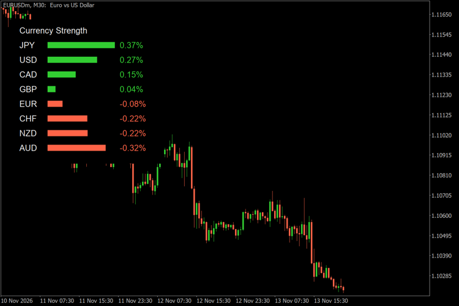
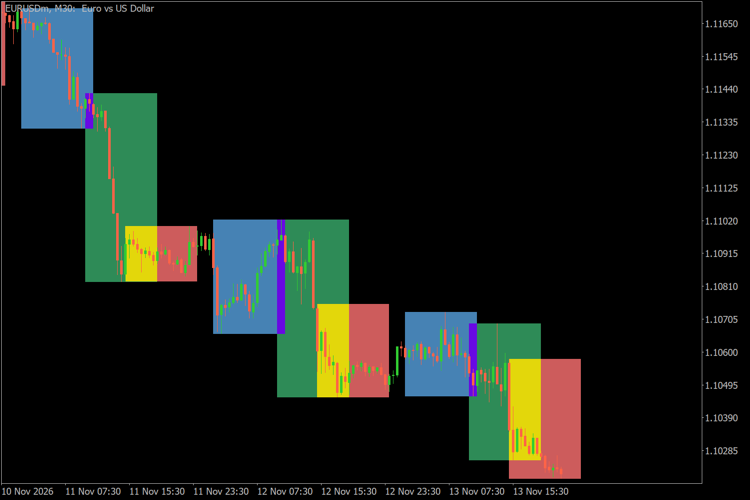
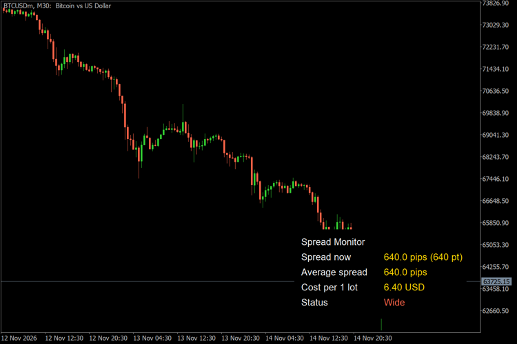

# Free MT5 Indicators

Three small, open-source indicators for MetaTrader 5. No DLLs, no licence checks, no trading functions: they only display information on the chart.

| Indicator | What it shows |
|---|---|
| [Currency Strength Meter](src/FXEA_Currency_Strength.mq5) | Ranks the 8 major currencies by relative strength |
| [Trading Session Highlighter](src/FXEA_Session_Highlighter.mq5) | Tokyo, London and New York sessions as coloured boxes |
| [Spread and Cost Monitor](src/FXEA_Spread_Monitor.mq5) | Live spread, average spread and the cost of a 1-lot trade |

## Currency Strength Meter

Strength is the average rate of change of each currency against the other seven over the last `InpLookback` bars of `InpTimeframe`. The panel compares the latest price with the close `InpLookback` bars ago, so the ranking updates as the current bar moves.

If your broker adds a suffix to symbol names (for example `EURUSDm` or `EURUSD.raw`), put it in `InpSuffix`.

## Trading Session Highlighter

Each session has its own on/off switch, start hour, end hour and colour. Hours are in broker server time, so adjust them to your broker's GMT offset. `InpDaysBack` limits how many days are drawn.

## Spread and Cost Monitor

Shows the current spread, the average spread since the indicator was attached, and the spread cost of a 1-lot trade in account currency. The status line changes colour when the spread exceeds `InpWarnSpread` points.

## Install

1. In MetaTrader 5, open **File > Open Data Folder**.
2. Copy the `.mq5` files into `MQL5/Indicators`.
3. Compile them in MetaEditor (F7), or restart the terminal.
4. Drag the indicator from the Navigator onto a chart.

## More

More free tools and EA backtest data: [fxea365.com](https://fxea365.com)

## License

[MIT](LICENSE)
